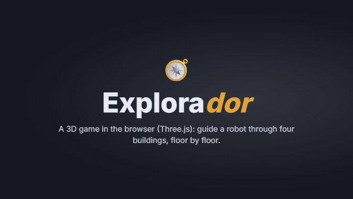

  
  &nbsp;
  

# Explorador

A 3D game in the browser (Three.js). You control a character walking through the floors of four buildings (A, B, C and D),
changing floors by elevator and buildings through passages (the portals).

🎬 Animated demo

## ▶️ Play

**https://diogoguedes0305.github.io/Explorador/**

Nothing to install: open it in Chrome, Edge or Firefox on a computer (you need a keyboard).
The first time it takes a few seconds to load (textures and 3D models).

## Keys

| Key | Action |
|---|---|
| ↑ ↓ ← → | Walk and turn |
| J | Jump |
| W / P / T / Y / N | Wave / punch / thumbs up / say yes / say no |
| 1 / 2 / 3 / 4 | Fixed view / first person / third person / top view |
| R | Realistic view |
| M | Mini-map |
| H | Help |
| U | Show/hide the options panel |
| A / D / S / F | Toggle lights (ambient, directional, spotlight, flashlight) |
| X / G | Shadows / fog |
| Z | Statistics (fps) |
| B | Collision volumes |

In the options panel you can choose the building and floor to start on, and the sky (skybox).

## How it's built

- `Index.html` — the page; loads Three.js 0.160 from a CDN (jsDelivr) through an *import map*.
- `thumb_raiser.js` — the game engine (cameras, keyboard, collisions, changing floors).
- `maze.js`, `wall.js`, `ground.js`, `door.js`, `elevator.js`, `passage.js` — building each floor from
  `buildings/*.json`.
- `player.js`, `animations.js` — the character and its animations (`models/`).
- `lights.js`, `fog.js`, `cubetexture.js`, `audio.js`, `user_interface.js` — lights, fog, sky, sounds and panel.

To run it on your own computer, serve the folder with any static server (for example `npx serve .`) and open `Index.html`.
The `three.js-master/`, `node_modules/` and `public/` folders aren't used by the page and aren't published.

Published automatically by GitHub Pages (`.github/workflows/pages.yml`) on every change to the `master` branch.

Credits for sounds, skies and textures: see the in-game panel (Dreamstime, Fesliyan Studios, Pixabay, OpenGameArt, TextureCan).
